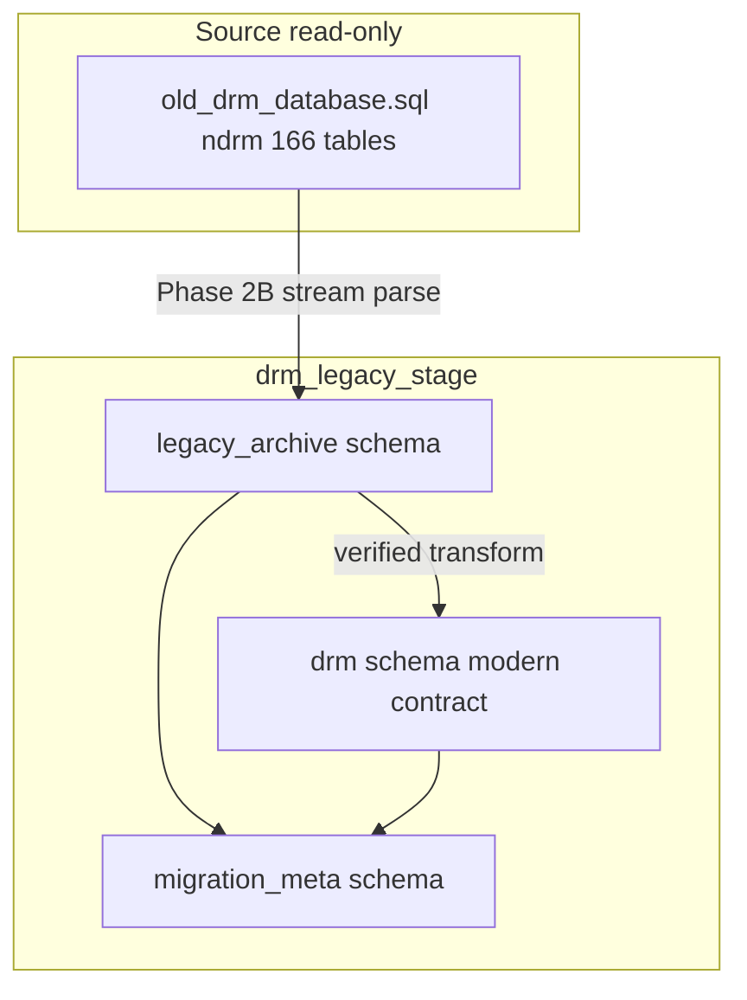

# Phase 2A — Migration architecture

**Database:** `drm_legacy_stage` (PostgreSQL 16.15, localhost)  
**Policy:** COPY, TRANSFORM & PRESERVE — never MOVE & DELETE  
**Authoritative backup:** `/var/www/DRM_raya/old_drm_database.sql` (unchanged)

## Three logical areas

| Schema | Purpose |
|--------|---------|
| **`drm`** | Modern application tables per `backend/src/shared/schema.ts` / Drizzle journal |
| **`legacy_archive`** | One table per MySQL source (166); **TEXT** columns preserve scalars losslessly |
| **`migration_meta`** | ID maps, batches, rejects, per-table status, per-record state, reconciliation candidates |

## Record state machine (Phase 2B)

Every source row must land in exactly one traceable state:

| State | Meaning |
|-------|---------|
| `ARCHIVED_ONLY` | Copied to `legacy_archive` only |
| `ARCHIVED_AND_MIGRATED` | Archive + successful modern insert |
| `ARCHIVED_PENDING_REVIEW` | Archive + flagged for reconciliation |
| `ARCHIVED_REJECTED` | Archive + reject log (transform failed for modern, **not** deleted) |

**Invariant:** `source_rows = archived_rows` (archive is mandatory for every imported source row).

## Duplicate source groups (preserved independently)

No merge in Phase 2A/2B until explicit reconciliation policy:

- `tbl_customers` ∥ `webxl_company`
- `tbl_invoices` ∥ `webxl_invoice` (+ `tbl_invitems`, `tbl_receipts`)
- `activity_logs` ∥ `webxl_activity_logs`
- `webxl_followup` / `webxl_followup_service` / `webxl_follow_up_services`
- GM / verify_gm* family
- Project/task families (`webxl_create_project`, `webxl_task_assign`, `webxl_task_links`, …)
- Communication/history (`webxl_com_*`, `webxl_log_history`, …)

`migration_meta.migration_reconciliation_candidates` stores **possible** links without overwriting.

## Related artifacts

- [`17-preservation-manifest.csv`](./17-preservation-manifest.csv) — 166 tables
- [`12-archive-schema-design.md`](./12-archive-schema-design.md)
- [`backend/scripts/migration/README.md`](../../backend/scripts/migration/README.md)
